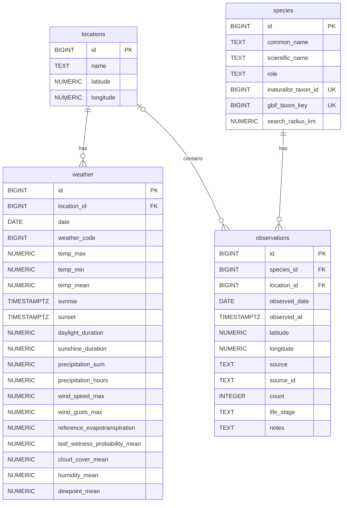

# PestControl

## Project concept

**End goal:**

A personal **garden intelligence and monitoring application** designed to help the user understand and manage conditions in their garden by combining external data sources, historical observations, weather information, local environmental information, and eventually some AI-assisted analysis.

## What has been done so far

### Project foundation

- [X] Created the Python project structure
- [X] Split the application into separate modules for configuration, database access, locations, species, observations, and weather
- [X] Added environment-based configuration using `.env`
- [X] Connected the application to a PostgreSQL database using `psycopg`
- [X] Added project dependencies to `requirements.txt`

### Database

- [X] Created and populated the database tables needed for locations, species, observations, and weather data
- [X] Added database connection handling

### Species and taxonomy

- [X] Integrated the GBIF species matching API
- [X] Integrated the iNaturalist taxonomy API
- [X] Added logic to match species between GBIF and iNaturalist
- [X] Store scientific names and common names
- [X] Store GBIF taxon keys and iNaturalist taxon IDs
- [X] Store a search radius for each species

### Observations

- [X] Integrated the iNaturalist observations API
- [X] Integrated the GBIF occurrence API
- [X] Added geographic-radius searches around configured locations
- [X] Added normalization of iNaturalist and GBIF observations into a common format
- [X] Store observation dates and timestamps, coordinates, the original data source and source ID, available metadata such as individual count, life stage, and notes
- [X] Observations have duplicate protection using `(source, source_id)` in the database

### Weather data

- [X] Integrated the Open-Meteo archive API
- [X] Added collection of daily weather variables relevant to garden monitoring
- [X] Store daily weather data in PostgreSQL
- [X] Weather has a duplicate protection using `(location_id, date)` in DB
- [X] Added a daily weather update function

### Automation / DevOps

- [X] Added a GitHub Actions workflow for automated weather updates
- [X] Configured the workflow to run daily at 10:00 in the `Europe/Bratislava` timezone
- [X] Added manual workflow triggering with `workflow_dispatch`
- [X] Configured the GitHub Actions environment to install the Python dependencies and run the weather update
- [X] Passed the database connection through a GitHub Actions secret
- [X] Added Docker configuration for the forecast API.
- [X] Complete backend deployment and production integration.

### Frontend and weather visualization

- [X] Initialized a React application using Vite.
- [X] Connected the frontend to Supabase using the Supabase JavaScript client.
- [X] Added a historical temperature chart using Recharts.
- [X] Visualized maximum, mean, and minimum temperatures.
- [X] Added interactive chart zooming and a reset-zoom control.
- [X] Added loading and error states for weather data retrieval.
- [X] Added a weather forecast component.
- [X] Added weather descriptions and icons instead of relying solely on numeric weather codes.
- [X] Added current, hourly, and daily weather information to the forecast interface.
- [X] Configure the production API URL after the backend has been deployed.

### Weather forecast API

- [X] Created a FastAPI backend to provide weather forecast data.
- [X] Integrated the Open-Meteo forecast API.
- [X] Added current weather conditions, hourly forecasts, and daily forecasts.
- [X] Configured the forecast location, timezone, and forecast duration.
- [X] Added a 15-minute in-memory forecast cache.
- [X] Added request timeouts and error handling for upstream API failures.
- [X] Added a manual forecast refresh endpoint with a cooldown.
- [X] Configured CORS using the `FRONTEND_ORIGINS` environment variable.
- [X] Added a Dockerfile for containerizing the backend.
- [X] Add and verify a deployment health-check endpoint.
- [X] Deploy the backend to Render's free web service.
- [X] Connect the deployed backend to the Vercel frontend.

The forecast API currently fetches data directly from Open-Meteo and does not require a database connection.

#### API endpoints

| Method | Endpoint                  | Purpose                                          |
| ------ | ------------------------- | ------------------------------------------------ |
| GET    | `/api/forecast`         | Retrieve the current forecast or a cached forecast |
| POST   | `/api/forecast/refresh` | Request a fresh forecast, subject to the cooldown  |
| GET    | `/healthz`              | Intended health-check endpoint                     |

The forecast endpoints return JSON. The refresh endpoint can return HTTP `429` when requests occur too frequently. Upstream weather-service failures are reported using HTTP `502`.

## Technology stack

- **Frontend:** React, Vite, JavaScript
- **Visualization:** Recharts
- **Database:** PostgreSQL, Supabase
- **Backend and data processing:** Python, psycopg, Requests
- **Weather data:** Open-Meteo API
- **Species and observations:** iNaturalist API, GBIF API
- **Backend API:** Python, FastAPI, Uvicorn
- **Frontend hosting:** Vercel
- **Backend hosting:** Render (setup in progress)
- **Containerization:** Docker
- **Automation:** GitHub Actions
